# Order and Inventory: REST and gRPC

This project implements the same Order → Inventory interaction using REST/HTTP and gRPC.

## Setup

Create and activate a virtual environment:

```bash
python3 -m venv .venv
source .venv/bin/activate
```

## REST

### Run

Start Inventory Service:

```bash
python rest_inventory.py
```
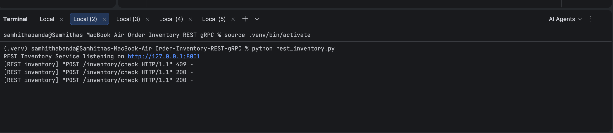

Start Order Service in another terminal:

```bash
python rest_order.py
```
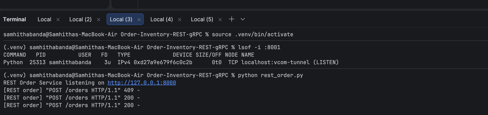

### Successful Request

```bash
curl -i -X POST http://127.0.0.1:8000/orders -H "Content-Type: application/json" -d '{"item_id":"book","quantity":2}'
```

Response:

```text
HTTP/1.0 200 OK
{"status": "accepted", "message": "order accepted", "remaining": 10}
```

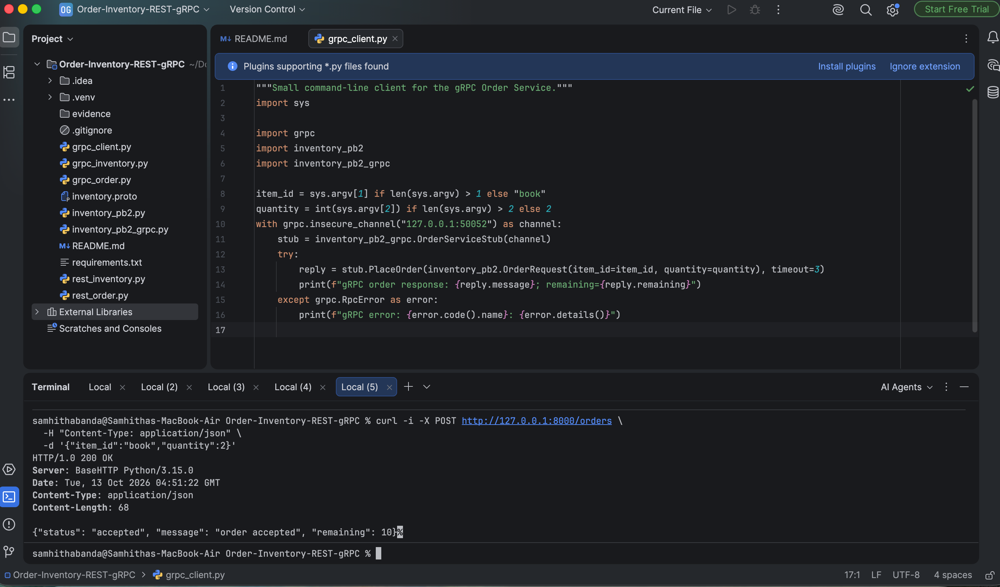

### REST Timeout

The Inventory Service was temporarily delayed for 4 seconds while the Order Service timeout was 1.5 seconds.

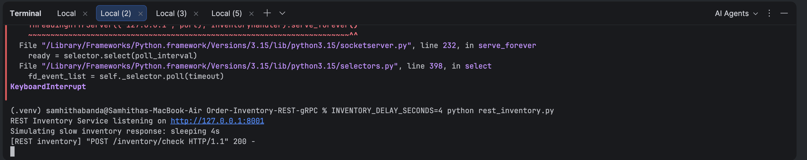

```text
HTTP/1.0 504 Gateway Timeout
{"error": "inventory request timed out"}
```
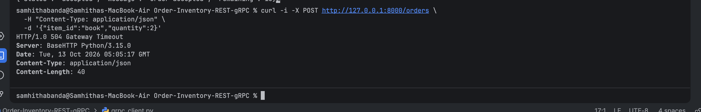


Order Service remained running:

```text
Inventory call timed out after 1.5s; Order Service is still running
```
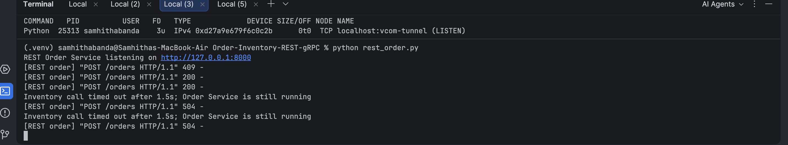

## gRPC

### Run

Start Inventory Service:

```bash
python grpc_inventory.py
```
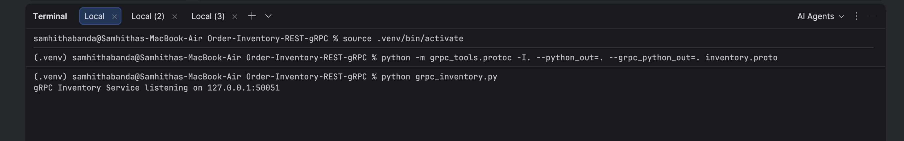

Start Order Service in another terminal:

```bash
python grpc_order.py
```
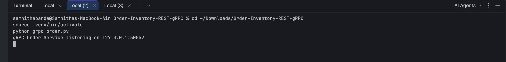

Run the client:

```bash
python grpc_client.py
```
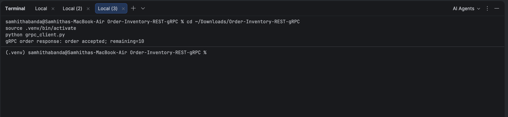

### Successful Request

```text
gRPC order response: order accepted; remaining=10
```


### gRPC Deadline

The Inventory Service was temporarily delayed for 4 seconds while the gRPC deadline was 1.5 seconds.
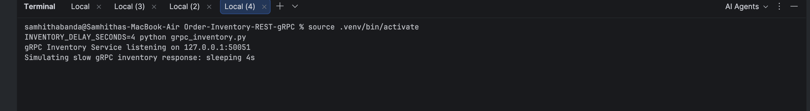

```text
gRPC error: DEADLINE_EXCEEDED: Deadline Exceeded
```
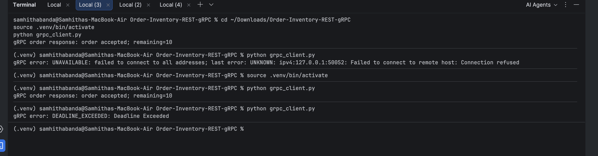

Order Service remained running:

```text
Inventory call exceeded 1.5s deadline; Order Service is still running
```
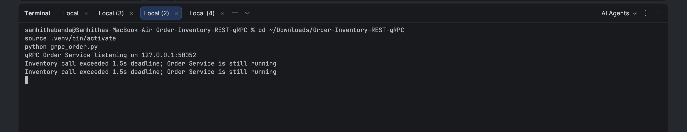

## REST vs gRPC

REST uses HTTP and JSON with HTTP status codes, while gRPC uses a `.proto` contract and strongly typed messages. REST was simpler to test manually with curl. gRPC provided built-in status handling such as `DEADLINE_EXCEEDED`. Both implementations handled slow Inventory responses without stopping the Order Service.